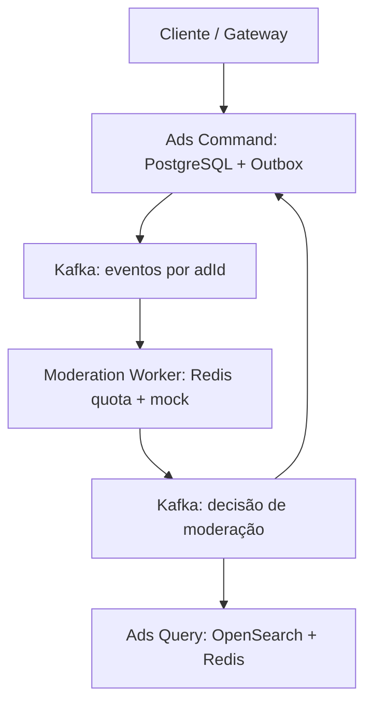

# Arquitetura e operação das duas soluções

Este documento separa o que atende ao desafio da evolução Enterprise. Números são hipóteses quando não marcados como medidos. Não há benchmark ponta a ponta registrado neste repositório.

## 1. Solução pequena: caminho síncrono

`solutions/simple` concentra HTTP, aplicação, integração externa e persistência em um deploy Spring Boot. O PostgreSQL é suficiente para o CRUD descrito, filtro por categoria e paginação. A aplicação envia ao mock somente os quatro campos documentados e espera a resposta antes de gravar. O anúncio aprovado fica disponível na listagem; o rejeitado é persistido para permitir consultar seu motivo.

Essa opção reduz deploys, contratos internos, custos e modos de falha. A latência do `POST` inclui a latência variável do mock. Se o mock responder 429, timeout ou erro, a aplicação devolve falha de dependência e não grava anúncio sem decisão. Não faz retry automático: uma repetição cega pode consumir novamente a quota ou duplicar uma chamada cujo resultado se perdeu.

## 2. Enterprise: componentes e ownership

`ads-service` é dono do anúncio e do estado operacional. `moderation-worker` é dono do registro de decisão e da coordenação de quota. `ads-query-service` mantém a projeção de consulta e o cache; não é fonte da verdade transacional. Kafka carrega eventos e não participa da transação do PostgreSQL.

### Cadastro, transação e Outbox

`AdController` valida o DTO e converte para `AdDraft`. `AdSubmissionService.submit` abre uma transação Spring/JPA e grava a entidade `ads`, as URLs em `ad_images` e o evento `outbox_events`. O evento da moderação leva `eventId`, versão, data, `adId`, título, descrição, preço e categoria em texto. Não contém URLs ou bytes de imagens.

Se qualquer gravação do método falhar, a transação PostgreSQL é revertida e nenhum anúncio sem evento fica confirmado. O método não chama rede nem Kafka dentro da transação. Isso evita segurar conexão enquanto espera dependência externa.

`OutboxRelay` busca até 100 candidatos, tenta reservá-los com atualização condicional no banco e publica no Kafka usando `adId` como chave. O lease expira para permitir recuperação de processo parado. Só marca PUBLISHED após confirmação do broker. Caso o broker confirme e o processo caia antes da marcação, o evento é enviado de novo; a garantia prática é at-least-once.

O retry do relay usa backoff exponencial com jitter, iniciando em 1, 2, 4, 8... e limitado a 60 segundos. A implementação não possui máximo de tentativas ou DLT para falhas permanentes do relay; monitorar idade da Outbox e definir retenção/alarme é uma pendência operacional deliberada. Não chamar esse fluxo de exactly-once.

### Moderação, limite externo e idempotência

`ModerationConsumer` lê o evento, pede um token a um bucket compartilhado no Redis e só então chama o mock. O bucket abastece 4 tokens/s, abaixo do máximo documentado de 5/s, para reservar margem. Redis quota é uma instância separada do Redis cache: usa `noeviction`, porque remover estado do limitador poderia liberar chamadas extras; o cache usa LRU. O limite de quota é compartilhado entre réplicas que apontam para a mesma instância. Se Redis quota cair, o consumidor falha fechado e não chama o mock sem coordenação; o backlog cresce até a dependência voltar.

O worker salva o resultado em `moderation_decisions`, com `eventId` como chave única, antes de publicar a decisão. Em uma repetição Kafka depois desse commit, ele reaproveita o resultado salvo e não consulta o mock de novo. Ainda há uma janela impossível de fechar sem apoio externo: o mock pode responder e o worker cair antes de persistir essa resposta; a mensagem reexecuta e pode consumir quota novamente. O contrato não oferece idempotency key.

`@RetryableTopic` tenta novamente com backoff limitado e jitter e encaminha falha persistente para DLT. Em 429, o worker respeita `Retry-After` inteiro até 30 segundos e depois entra no retry do Kafka. A DLT precisa de alerta, inspeção e processo de replay; não é descarte automático. O consumidor de decisão do Ads atualiza estado por `adId`; repetir o mesmo estado é idempotente. O consumidor da consulta usa `_id=adId` no OpenSearch, então repetir upsert também converge.

### Projeção de consulta e leitura

`AdProjectionConsumer` indexa no OpenSearch apenas decisões aprovadas. A busca usa texto em título/descrição, filtro exato por categoria e cursor `search_after`, ordenado por `createdAt desc` e `adId asc`. É um índice invertido para texto, separado do PostgreSQL transacional. A atualização é eventual: entre a decisão e a projeção, uma busca pode não mostrar o anúncio.

O evento de moderação não contém imagens. Para detalhe, `ads-query-service` confere a presença do anúncio aprovado no índice e consulta o Ads Command para hidratar URLs. Redis cache guarda o detalhe por 4 a 6 minutos com jitter; a chave é invalidada ao consumir uma nova decisão. Esse desenho evita imagens no evento de moderação, mas cria chamada interna no cache miss. A busca entrega resumo sem imagens. Se o produto exigir imagem em cada card de busca, a ambiguidade precisa ser resolvida com uma projeção de mídia separada, sob contrato próprio.

Para evitar stampede, o detalhe usa lock Redis por chave, token aleatório e liberação compare-and-delete. O TTL do lock é cinco segundos; o TTL do dado recebe jitter. Em falha de Redis, a consulta faz fallback para OpenSearch e Ads Command com bulkhead local de 32 operações. Acima disso, responde 503 para proteger as dependências. Redis indisponível reduz capacidade e piora latência; não há alegação de que o fallback mantenha a meta de performance.

O cursor atual usa `search_after`, mas não abre Point-in-Time. Alterações no índice durante navegação podem mudar a sequência entre páginas. O cliente deve manter a mesma consulta e categoria ao reutilizar o cursor. Para uma sessão de busca estável, usar PIT e incluir seu identificador/expiração no cursor, com limpeza e limite de duração.

### Fronteiras de consistência

- PostgreSQL Ads: anúncio e estado são fonte transacional.
- Outbox Ads: publicação recuperável; duplicatas são possíveis.
- Kafka: eventos persistentes dentro da retenção configurada; chave `adId` preserva ordem do mesmo anúncio dentro de uma partição.
- PostgreSQL Moderation: registra decisão por `eventId` para reduzir chamadas repetidas após persistência.
- OpenSearch: projeção eventual de anúncios aprovados; reconstruível somente com uma fonte durável de eventos/dados e procedimento de reindexação.
- Redis: quota global e cache descartável; não é dono dos anúncios nem das decisões.

Não existe transação atômica entre PostgreSQL Ads, Kafka, mock HTTP, PostgreSQL Moderation, OpenSearch e Redis. Cada fronteira tem retry, duplicação e métrica próprios.

## 3. Contratos HTTP

### Solução pequena e Ads Command

- `POST /ads`: JSON `{title, description, price, category, images}`. A solução pequena espera moderação e responde `201`. Ads Command Enterprise responde `202` com `PENDING_MODERATION`.
- `GET /ads?page=0&size=20&category=eletronicos`: anúncios aprovados, paginação do PostgreSQL.
- `GET /ads/{uuid}`: detalhe, status e motivo quando rejeitado.

### Consulta Enterprise

- `GET /ads/search?q=notebook&category=eletronicos&size=20&cursor=...`: busca em OpenSearch; `nextCursor` pode ser enviado na próxima chamada.
- `GET /ads/{uuid}`: detalhe aprovado, cacheado em Redis; URLs são hidratadas do Ads Command.
- Via Gateway, `GET /api/ads` e `GET /api/ads/` encaminham para a busca OpenSearch (`/ads/search`); `GET /api/ads/search` e `GET /api/ads/search/...` também usam a busca explícita; `GET /api/ads/{uuid}` encaminha para o detalhe do serviço de consulta; `POST /api/ads` encaminha para Ads Command. `GET /api/search/...` é um alias de busca. As rotas diretas dos serviços continuam disponíveis no laboratório para facilitar inspeção.

## 4. Dados, índices e complexidade

`AdDraft` percorre `n` URLs e processa os caracteres somados B durante normalização/validação: custo O(n+B), memória dos resultados O(n+B). Essa notação não protege contra entrada ilimitada; o desafio não informa limite para descrição, número de imagens ou tamanho de URL. Uma política de bytes e contagem máxima precisa ser acordada antes de exposição pública.

PostgreSQL cria índices `(status, created_at DESC)` e `(status, category, created_at DESC)` para listagens; a consulta deve ser conferida com `EXPLAIN (ANALYZE, BUFFERS)` no dataset de teste. `OFFSET` pode ficar caro em páginas profundas; serviço de consulta usa cursor para evitar varrer e descartar todas as páginas anteriores.

Heap/CPU/pods não são deduzidos só de RPS. A estimativa precisa usar ocupação concorrente (Lei de Little), tempo segurando conexão, bytes retidos/alocados por requisição, limite de CPU/memória do container, throughput medido por instância e cauda de latência. As hipóteses e contas disponíveis estão no `DECISIONS.md`; elas não são benchmark do sistema completo.

## 5. Operação local e observabilidade

Compose Enterprise é um laboratório: um broker Kafka, OpenSearch single-node, Redis local e PostgreSQL. Replicação Kafka 1, sem failover, não representa produção. Prometheus coleta Actuator; Spring/Micrometer fornece HTTP, JVM, processo e métricas de cliente disponíveis. A configuração não prova ainda dashboard completo nem coleta de lag Kafka, idade da Outbox, número de retries, quota e atraso da projeção; esses indicadores precisam de instrumentação explícita antes de alegar cobertura de operação.

Indicadores mínimos para a próxima iteração:

- cadastro: throughput, respostas 202/4xx/5xx e tempo de transação;
- Outbox: pendências, idade do evento mais antigo, tentativas e erros;
- moderação: chamadas por segundo, 429, timeout, decisões, backlog, retry topic e DLT;
- consulta: p50/p95/p99, resultado/cursor, lag do consumidor, latência do OpenSearch;
- Redis: hit/miss, fallback, lock contention, rejeições do bulkhead e memória;
- recursos: CPU/throttling, RSS, heap pós-GC, pausas/alloc rate, threads e conexões PostgreSQL.

## 6. Como defender a arquitetura

Para o desafio: escolher a solução pequena porque o contrato é CRUD moderado, não há RPS ou SLO e o evaluador pede escopo de poucas horas. A API síncrona torna “moderar antes de publicar” direto e deixa a operação simples. A limitação é latência/indisponibilidade do mock.

Para a evolução: escolher a Enterprise somente quando teste e requisito mostrarem que gravação desacoplada, busca textual, escala de leitura, cache quente ou isolamento de falha justificam o custo. Kafka/Outbox protegem durabilidade, não aumentam a quota do mock. Redis/OpenSearch aceleram padrões específicos, adicionando consistência eventual e operação. A decisão final deve ser revisada com p50/p95/p99, throughput concluído, CPU, heap/GC, conexões, lag, hit ratio e custo medidos.
